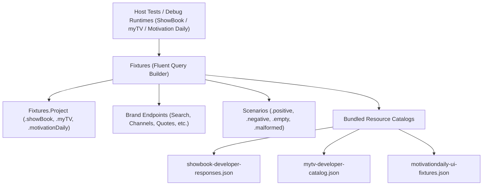
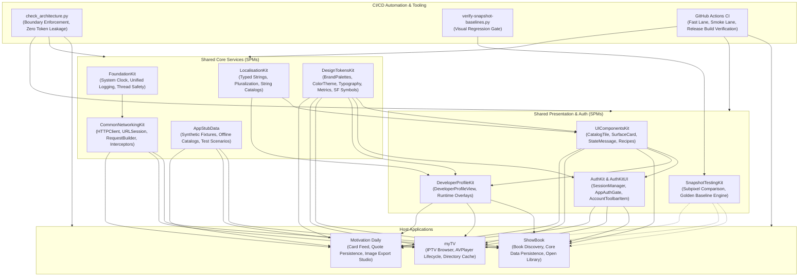

# AppStubData

Shared offline JSON fixtures, scenario catalogs, and strongly typed mock response builders for multi-project architectures (**ShowBook**, **myTV**, and **Motivation Daily**).


-success)


---

## 1. Executive Summary & Purpose

`AppStubData` centralizes mock network payloads, scenario responses, and test data catalogs into a single, version-controlled repository (IOS-65). It decouples test data from application production bundles, ensuring that developer fixtures, UI test seeds, and deterministic offline mock catalogs are shared without code duplication or fixture leakage into production releases.

### Key Engineering Objectives:
- **Centralized Offline Fixtures**: Houses real payload structures for Open Library (`showbook-developer-responses.json`), IPTV directory metadata (`mytv-developer-catalog.json`), and motivational quote feeds (`motivationdaily-ui-fixtures.json`).
- **Fluent Typed Query Builders**: Replaces error-prone disk path resolution with type-safe, brand-specific query builders (`Fixtures.data(for:).endpoint().scenario()`).
- **Zero Leakage into Release Binaries**: Consumed strictly in Debug schemes, Showcase builds, and XCTest bundles. Release targets never package or embed test fixtures.
- **Pure Foundation**: Operates with zero third-party or visual framework dependencies.

---

## 2. Architecture & Design Principles



---

## 3. Dependency Graph & Consumer Matrix

| Direction | Package / Project | Responsibility |
|---|---|---|
| **Upstream Dependencies** | *None* | Pure Apple `Foundation`. Zero external dependencies. |
| **Downstream Consumers** | **ShowBook** | Offline Open Library responses for search, details, and edition pagination in Debug and XCTest. |
| | **myTV** | Offline IPTV-org channel listings, stream directories, and logos for Developer Showcase and Snapshot lanes. |
| | **Motivation Daily** | Offline quote feeds, author bibliographies, and sample wallpaper fixtures for UI test flows. |

---

## 4. API Contracts & Practical Code Examples

### 1. Fluent Data Query Builder
```swift
import Foundation
import AppStubData

// ShowBook Search Empty Scenario
let emptySearchData = try Fixtures.data(for: .showBook)
    .endpoint(.search)
    .scenario(.empty)

// myTV Channels Positive Directory
let channelCatalogData = try Fixtures.data(for: .myTV)
    .endpoint(.channels)
    .scenario(.positive)

// Motivation Daily Quotes Seed Data
let quotesData = try Fixtures.data(for: .motivationDaily)
    .endpoint(.quotes)
    .scenario(.positive)
```

### 2. Injecting Offline Fixtures into Mock URLProtocol
```swift
import Foundation
import CommonNetworkingKit
import AppStubData

final class OfflineCatalogProtocol: URLProtocol {
    override func startLoading() {
        do {
            let mockData = try Fixtures.data(for: .showBook)
                .endpoint(.search)
                .scenario(.positive)
            
            let response = HTTPURLResponse(
                url: request.url!,
                statusCode: 200,
                httpVersion: "HTTP/1.1",
                headerFields: ["Content-Type": "application/json"]
            )!
            
            client?.urlProtocol(self, didReceive: response, cacheStoragePolicy: .notAllowed)
            client?.urlProtocol(self, didLoad: mockData)
            client?.urlProtocolDidFinishLoading(self)
        } catch {
            client?.urlProtocol(self, didFailWithError: error)
        }
    }
}
```

---

## 5. Verification & Testing

```sh
# Run AppStubData catalog parsing and scenario integrity tests
swift test

# Build package
swift build
```

---

## 6. End-to-End Ecosystem Connectivity



---

## 7. Canonical Notion Dashboards & Governance Links

- [iOS Portfolio — Engineering Tickets Dashboard](https://app.notion.com/p/c20d7f4b133b44499c8ac0b4d5f6249e?pvs=204)
- [iOS Portfolio — Master Document](https://app.notion.com/p/40ffa5f855b98192ad2ede66a5d36fe7)
- [Architecture Boundary Validator (`check_architecture.py`)](file:///Users/anuragchourasia/Desktop/Projects/UIComponentsKit/Scripts/check_architecture.py)
- [Release & Gate Policy Documentation (`Docs/MASTER.md`)](file:///Users/anuragchourasia/Desktop/Projects/Docs/MASTER.md)
